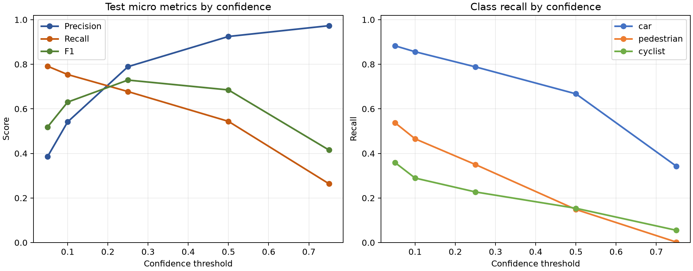
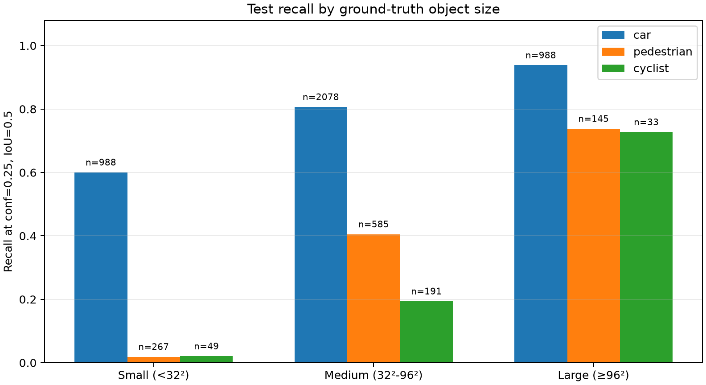

# YOLOv8 Fine-tuning — KITTI car / pedestrian / cyclist

충북대학교 소프트웨어학부 머신러닝 과제 2를 위한 재현 가능한 객체 탐지·추적 프로젝트입니다. KITTI 라벨을 정확히 3개 클래스로 재매핑하고, COCO 사전학습 YOLOv8n을 Apple M1 Pro MPS에서 실제 fine-tuning한 뒤 독립 test 분할과 5초 ByteTrack 영상으로 검증합니다.

최대 30 Epoch로 설정했으며, 8 Epoch 동안 validation mAP 개선이 없어 16 Epoch에서 조기 종료되었습니다. 최적 validation 성능은 8 Epoch의 `best.pt`입니다.

## 실제 결과

| 평가 | Precision | Recall | mAP@0.5 | mAP@0.5:0.95 |
|---|---:|---:|---:|---:|
| Validation best (Epoch 8) | 0.7966 | 0.6819 | 0.7177 | 0.4062 |
| Held-out Test (1,076장) | 0.6612 | 0.4535 | 0.5035 | 0.2692 |

| Test 클래스 | Precision | Recall | mAP@0.5 | mAP@0.5:0.95 |
|---|---:|---:|---:|---:|
| car | 0.8235 | 0.7873 | 0.8409 | 0.5609 |
| pedestrian | 0.7468 | 0.3461 | 0.4426 | 0.1474 |
| cyclist | 0.4134 | 0.2271 | 0.2269 | 0.0995 |

- 실제 학습 시간: 3,752.55초(1시간 2분 33초), Apple M1 Pro MPS
- 최종 모델: [`models/best.pt`](models/best.pt), SHA-256 `7228f60ae38af5ca3dd1ec88686003bdcb0571aa4f865821b6caaf73a0cb8264`
- 5초 추적 영상: [`videos/kitti3_tracking_5s.mp4`](videos/kitti3_tracking_5s.mp4), 정확히 5.000초/150프레임/H.264
- 추적 결과: 1,244개 검출 모두 track ID 포함, car/pedestrian/cyclist 모두 등장
- 한국어 보고서: [`reports/final_report.pdf`](reports/final_report.pdf)
- 상세 수치: [`results/metrics/test_metrics.json`](results/metrics/test_metrics.json), [`results/metrics/additional_analysis.json`](results/metrics/additional_analysis.json), [`results/metrics/final_verification.json`](results/metrics/final_verification.json)

## 추가 진단 실험(재학습 없음)

기존 `best.pt`를 변경하지 않고 Test 예측을 confidence별로 재평가했습니다. 아래 값은 IoU 0.5의 고정 threshold micro 지표로, 공식 mAP와는 다른 운영점 분석입니다.

| Confidence | Precision | Recall | F1 |
|---:|---:|---:|---:|
| 0.05 | 0.3855 | 0.7913 | 0.5184 |
| 0.10 | 0.5414 | 0.7539 | 0.6302 |
| 0.25 | 0.7891 | 0.6775 | 0.7291 |
| 0.50 | 0.9246 | 0.5438 | 0.6848 |
| 0.75 | 0.9730 | 0.2639 | 0.4152 |

- 표본 threshold 중 0.25에서 micro F1이 가장 높았습니다. threshold를 낮추면 Recall과 FP가 함께 늘고, 높이면 Precision과 FN이 함께 늘었습니다.
- conf 0.25에서 small/medium/large Recall은 pedestrian `0.0187/0.4051/0.7379`, cyclist `0.0204/0.1937/0.7273`이었습니다. 크기 구간은 원본 영상 좌표의 COCO식 진단 기준이며 KITTI 공식 지표가 아닙니다.
- Validation/Test의 이미지당 개체 수는 `2.458/4.948`이었습니다. Validation pedestrian은 large 76.6%, small 0.0%였지만 Test는 large 14.5%, small 26.8%여서 보행자 분포 이동이 확인되었습니다.
- cyclist는 Validation의 small 비율이 더 높았는데도 Test 성능이 낮아, 분할 차이를 객체 크기만으로 설명할 수 없었습니다. 조밀도·가림·장면 차이는 가능한 가설이지만 이번 실험에서 원인별 효과를 분리하지 않았습니다.





## 클래스와 데이터

Ultralytics KITTI 변환본의 원본 클래스는 `0 car, 1 van, 2 truck, 3 pedestrian, 4 person_sitting, 5 cyclist, 6 tram, 7 misc`입니다. 이 프로젝트는 다음 세 클래스만 유지합니다.

| 원본 ID | 원본 이름 | 최종 ID | 최종 이름 |
|---:|---|---:|---|
| 0 | car | 0 | car |
| 3 | pedestrian | 1 | pedestrian |
| 5 | cyclist | 2 | cyclist |

| 분할 | 이미지 | car 이미지/개체 | pedestrian 이미지/개체 | cyclist 이미지/개체 |
|---|---:|---:|---:|---:|
| Train | 5,226 | 4,908 / 22,450 | 1,076 / 3,025 | 794 / 1,159 |
| Validation | 1,179 | 739 / 2,238 | 442 / 465 | 176 / 195 |
| Test | 1,076 | 1,037 / 4,054 | 261 / 997 | 171 / 273 |

배포된 KITTI 탐지 변환본에는 촬영 시퀀스 ID가 없습니다. 원본 분할에서 가까운 장면이 양쪽에 섞인 사례를 확인했기 때문에 pHash·dHash·축소 RGB 유사도로 3,856개 장면 그룹을 만들고, 그룹 단위 70/15/15 분할을 수행했습니다. 동일 SHA-256 이미지와 추정 장면 그룹의 split 간 중복은 0건이지만, 시각적으로 덜 유사한 동일 주행 프레임까지 완전히 식별했다고 보장할 수는 없습니다.

## 환경

- MacBook Pro 18,3, Apple M1 Pro (8-core CPU / 14-core GPU), 16 GB
- macOS 15.3.2, Python 3.12.9
- PyTorch 2.15.0, Ultralytics 8.4.215
- 실제 MPS convolution backward, 1 Epoch smoke test, 전체 1 Epoch 벤치마크 통과
- 전체 벤치마크: 약 4분 3초/Epoch, `imgsz=640`, `batch=8`; 실제 16 Epoch 1시간 2분 33초

PyTorch가 MPS의 일부 연산에 대해 비결정론 경고를 냅니다. seed와 deterministic 옵션을 고정했지만 비트 단위 동일성은 보장하지 않으며, 대신 환경·데이터·가중치 SHA-256과 전체 설정을 기록합니다.

## 설치 및 재현

Python 3.12와 `ffmpeg`/`ffprobe`가 필요합니다.

```bash
python3.12 -m venv .venv
source .venv/bin/activate
pip install -r requirements.txt
```

데이터 다운로드, SHA-256 검증, 추출, 클래스 재매핑, 장면 그룹 분할과 검증:

```bash
python src/download_data.py --asset all
python src/prepare_dataset.py
python src/validate_dataset.py
```

Apple Silicon MPS 확인과 학습:

```bash
PYTORCH_ENABLE_MPS_FALLBACK=1 YOLO_CONFIG_DIR=.cache/ultralytics \
  python src/check_environment.py

PYTORCH_ENABLE_MPS_FALLBACK=1 YOLO_CONFIG_DIR=.cache/ultralytics \
  python src/train.py --mode smoke

PYTORCH_ENABLE_MPS_FALLBACK=1 YOLO_CONFIG_DIR=.cache/ultralytics \
  python src/train.py --mode benchmark --epochs 1 --batch 8 --imgsz 640

PYTORCH_ENABLE_MPS_FALLBACK=1 YOLO_CONFIG_DIR=.cache/ultralytics \
  python src/train.py --mode full --epochs 30 --batch 8 --imgsz 640 \
  --name yolov8n_kitti3_30e
```

완료된 run을 제출용 아티팩트로 승격하고 test 평가·추적·보고서를 생성합니다.

```bash
python src/finalize_training.py
python src/evaluate.py
python src/analyze_diagnostics.py --device mps --batch 8
python src/track_video.py
python src/generate_report.py --author "김문기" --student-id "2021041023"
```

테스트:

```bash
pytest -q
```

Google Colab 보조 노트북은 [`notebooks/colab_training.ipynb`](notebooks/colab_training.ipynb)에 있습니다. 로컬 제출 실험은 MPS에서 수행했으므로 Colab CUDA 재실행은 별도 실험으로 취급해야 합니다.

## 프로젝트 구조

```text
configs/       데이터·학습·추적 설정
models/        제출용 fine-tuned best.pt
notebooks/     Colab 재현 노트북
reports/       한국어 최종 PDF
results/       지표 JSON/CSV, 그래프, 성공·실패 사례
src/           다운로드, 전처리, 검증, 학습, 평가, 추적, 보고서 코드
tests/         클래스 재매핑과 평가 유틸리티 테스트
videos/        5초 추적 MP4
```

원본 데이터, 원본 영상, 강의 PDF, 가상환경, Ultralytics 임시 run은 Git에 포함하지 않습니다. `models/best.pt`, 선택된 결과 그림·지표, `videos/kitti3_tracking_5s.mp4`, `reports/final_report.pdf`만 제출 아티팩트로 관리합니다.

## 출처와 이용 조건

- [KITTI Vision Benchmark Suite](https://www.cvlibs.net/datasets/kitti/): 연구진은 학술 목적 사용 가능하다고 안내합니다. 원본 전체를 저장소에 재배포하지 않습니다.
- [Ultralytics KITTI dataset configuration](https://github.com/ultralytics/ultralytics/blob/main/ultralytics/cfg/datasets/kitti.yaml): YOLO 변환본의 URL과 클래스 정의를 검증했습니다.
- 추적 영상: German Korb, [Video Of Cityscape During Daytime](https://www.pexels.com/video/video-of-cityscape-during-daytime-4772894/).
- [Pexels License](https://www.pexels.com/license/): 무료 사용과 수정을 허용하며 출처 표시는 필수가 아닙니다. 이 프로젝트는 제작자와 원본을 명시합니다.
- [Ultralytics YOLOv8](https://docs.ultralytics.com/models/yolov8/), [Train](https://docs.ultralytics.com/modes/train/), [Track](https://docs.ultralytics.com/modes/track/).

데이터, 파생 모델, 소프트웨어 및 영상의 공개 조건은 [`NOTICE.md`](NOTICE.md)에 정리했습니다. `best.pt`는 KITTI 조건에 따라 과제·학술·비상업 용도로만 제공하며, 원본 KITTI 데이터와 원본 Pexels 영상은 저장소에 포함하지 않습니다.

교수님 강의자료는 로컬 분석에만 사용했으며 공개 저장소에서 제외합니다.

## 공개 상태

공개 저장소: [mk-isos/ML-YOLO-Assignment2](https://github.com/mk-isos/ML-YOLO-Assignment2)
